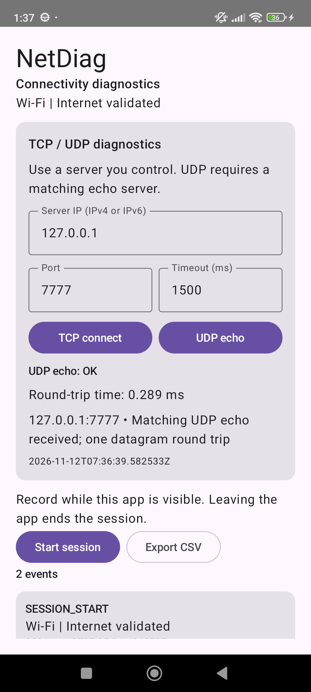
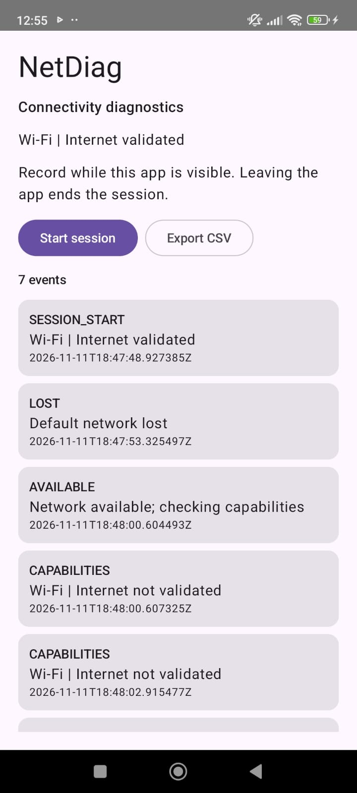
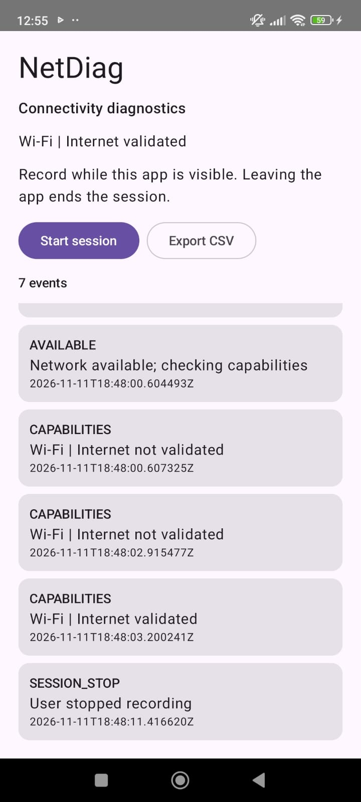

# NetDiag — Android Connectivity Diagnostics

[](https://github.com/Fazlul105/NetDiag/actions/workflows/android.yml)

A Kotlin and Jetpack Compose app that records Android network changes and runs
C++ TCP-connect and UDP-echo diagnostics through the Android NDK and JNI.

**Status: working v0.2 feature branch, in development.** Tested on a Redmi Note 11
running Android 13. C++ TCP/UDP probes, JNI integration, cancellation, and native
tests are implemented. AIDL and audio transport remain planned milestones.

## What it does

- Observes the app's default network with `ConnectivityManager.NetworkCallback`.
- Displays Wi-Fi, cellular, Ethernet, or VPN transport when reported by Android.
- Distinguishes network availability from Android-validated internet access.
- Records UTC and monotonic timestamps for network events in a start/stop session.
- Shows the event timeline and exports CSV through Android's document picker.
- Unregisters callbacks when monitoring ends and retains state across rotation.
- Runs one TCP connection or UDP echo probe against a numeric IPv4/IPv6 endpoint.
- Handles deadlines, cancellation, connection refusal, and malformed UDP echoes
  in C++ with RAII socket ownership; executes native work off the UI thread.
- Returns typed native results through registered JNI methods to observable UI state.

## Screenshots

Native UDP echo to a device-local test server (a JNI demonstration, not Wi-Fi RTT):



The v0.1 screenshots below show the same seven-event connectivity session:

<p>
  
  
</p>

## Verified results

| Check | Result |
| --- | --- |
| Debug APK build | Passed |
| JVM unit tests | 7 passed |
| C++ socket tests on Android ARM64 | 10 passed |
| Portable C++ socket tests on Linux CI | 10 passed |
| Android JNI/ViewModel integration tests | 7 passed |
| Manual TCP/UDP app controls | User confirmed both OK; UDP result captured |
| Android lint | 0 errors; 7 version-update advisories |
| Physical device | Redmi Note 11, Android 13 / API 33 |
| Manual Wi-Fi disconnect/reconnect recording | Passed once; 7 exported events |
| CSV validation | Expected columns, parseable UTC, strictly increasing monotonic timestamps |

Read the [device-test report](docs/results/2026-11-12-redmi-wifi.md) and inspect
the [actual exported CSV](docs/examples/redmi-wifi-session.csv). The report
distinguishes observed callback intervals from network-performance benchmarks.
The [remaining device checks](docs/DEVICE_TESTS.md) are explicitly marked pending.
See the [native milestone report](docs/results/2026-11-12-native-diagnostics.md)
and [implementation walkthrough](docs/NATIVE_DIAGNOSTICS.md) for the C++/JNI work.

## Build and run

### Requirements

- JDK 21.
- Android Studio or Android SDK command-line tools.
- Android SDK platform 36 and build tools 36.0.0.
- Android NDK 27.2.12479018, used when packaging native dependencies.
- SDK CMake 3.22.1.
- An Android 8.0+ ARM64 device or x86_64 emulator; real cellular testing requires a phone.

Install the pinned SDK packages through Android Studio's SDK Manager, or with
the current Android CLI:

```sh
android sdk install platforms/android-36 build-tools/36.0.0 ndk/27.2.12479018 cmake/3.22.1
```

Set `JAVA_HOME` to JDK 21 and `ANDROID_HOME` to your Android SDK. Android Studio
can also configure an ignored `local.properties` with your SDK location.

```sh
git clone --branch feat/native-diagnostics https://github.com/Fazlul105/NetDiag.git
cd NetDiag
./gradlew --no-daemon assembleDebug testDebugUnitTest lintDebug
```

On Windows, use `gradlew.bat` in place of `./gradlew`. The wrapper pins Gradle
8.13 and verifies its distribution checksum. The project uses AGP 8.13.2,
Kotlin 2.2.21, and minimum SDK 26. Native libraries are built for arm64-v8a and
x86_64, with 16 KB ELF segment alignment enabled.

The APK is generated at `app/build/outputs/apk/debug/app-debug.apk`. GitHub
Actions also uploads the debug APK and test/lint reports as workflow artifacts.

### Install on a phone

Enable USB debugging and authorize your computer on the phone, then run:

```sh
adb devices -l
./gradlew installDebug
adb shell am start -n dev.netdiag/.MainActivity
```

Some Xiaomi devices also require **Install via USB** in Developer options.
With multiple devices, select the intended device explicitly.

Optional PowerShell helpers are in `tools/`. They load `tools/local-env.ps1`
if present; this ignored file can configure workstation-specific environment
variables. `tools/run-on-device.ps1` installs an already built APK, accepting
an optional `-Serial` argument.

### Try a session

1. Open NetDiag and tap **Start session**.
2. Switch Wi-Fi off and back on using the notification shade.
3. Return to NetDiag, tap **Stop session**, and choose **Export CSV**.
4. Compare the recorded events with the actions you performed.

## Design and limitations

`MainActivity` renders the UI and owns the export picker. `DiagnosticsModel`
observes network callbacks and exposes immutable state. `Session` holds the
Android-independent recording and CSV logic. The portable C++ socket core lives
in `native/`; `NativeProbeModel` dispatches JNI work on an IO worker and exposes
the result to Compose. Native results are separate from the event-session CSV.

Recording runs while the app is visible and ends when the app leaves the
foreground. Sessions are kept in memory until exported; process termination
loses unexported data. Android's internet-validation flag does not guarantee
that a particular server is reachable. Current device evidence is one manual
Wi-Fi scenario, not a repeated benchmark or a cellular handover study.

See the [architecture notes](docs/ARCHITECTURE.md) and
[validation record](docs/SETUP_STATUS.md) for details.

## Roadmap

- **Current:** connectivity recording/CSV plus C++ TCP-connect timing and UDP echo
  through JNI, with deadlines, cancellation, and native/integration tests.
- **Next:** repeatable LAN measurements, native-result export, and a separate-process
  AIDL service.
- **Later:** audio transport and repeatable
  interruption/recovery investigations.
- **Optional:** supported hardware peripherals, Linux drivers, and Android
  platform/HAL work in an appropriate environment.

See the [milestone plan](docs/ROADMAP.md). The current native work is
application-level networking. HAL, kernel-driver, modem, and physical-bus work
remain separate milestones.

## Development

Developed by [Md. Fazlul Karim](https://github.com/Fazlul105) with OpenAI Codex
assistance. Build results, unit tests, and manual device observations are
documented separately from planned features.
