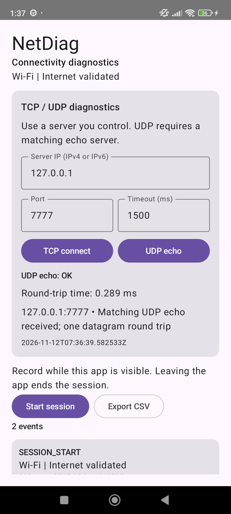

# Native diagnostics milestone — v0.2

Device: Redmi Note 11, Android 13 / API 33. Date: 12 November 2026, Asia/Dhaka.

## Implemented

- Portable C++17 numeric-IP TCP connection timing and UDP echo RTT.
- Nonblocking sockets, a shared steady-clock deadline, and cancellation checks.
- RAII descriptor cleanup, TCP SO_ERROR inspection, and exact UDP payload matching.
- JNI method registration, shared request ownership, typed result objects, and
  background Kotlin workers connected to the app's observable UI state.
- ARM64 and x86_64 native libraries; LOAD segment alignment verified as 0x4000.

## Verification

| Check | Outcome |
| --- | --- |
| Android debug build | Passed |
| JVM unit tests | 7 passed |
| Native socket tests executed on Android ARM64 | 10 passed |
| Android JNI and ViewModel integration tests | 7 passed, 0 failures/errors/skips |
| Android lint | 0 errors; 7 dependency-update advisories |
| Debug APK signature | Verified |
| Manual app controls against device-local C++ echo server | User reported TCP and UDP both OK |

The native cases cover invalid input, TCP connect/refusal, UDP echo/timeout/
malformed responses, cancellation before/during work, 25 repeated timeout/error
iterations without a descriptor-count increase, and IPv6 TCP/UDP.

The connected tests exercise five JNI behaviors and two ViewModel-to-native-to-
state paths against owned Java loopback servers. An initial ActivityScenario-
based UI test launch stalled on this Redmi. The app opened normally through ADB;
those stalled tests were replaced by direct controller integration tests. Button
interaction was then checked manually, and the UDP result was captured.

Linux host tests are configured in the native-tests CI job. Its run status is
visible in GitHub Actions for the feature branch.

## Manual result

The C++ echo server ran on the phone at 127.0.0.1:7777. The user entered that
address, port 7777, and timeout 1500 ms, then pressed both probe buttons and
reported OK for both. The captured UDP result shows a matching 32-byte echo and
an RTT of 0.289 ms.

That value is a single **device-loopback** measurement. It is not Wi-Fi latency,
a cellular test, a throughput result, or a statistically repeated benchmark.
The TCP measurement was user-reported OK; a numeric TCP screenshot was not saved.

Tested debug APK: 11,196,771 bytes. SHA-256:
`5CE153CA90C7AC2B57F23F6EF99D369E963B47691B16559B6C3C13B5028385E0`

## Remaining work

Repeatable LAN and Wi-Fi/mobile-transition probes, native-result CSV export,
IPv6 zone IDs, and hostname resolution remain follow-up work. AIDL, audio,
HAL, modem, kernel-driver, and hardware-bus implementation are not established
by these application-level socket tests.
